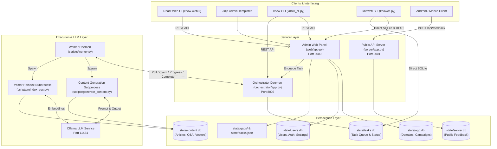
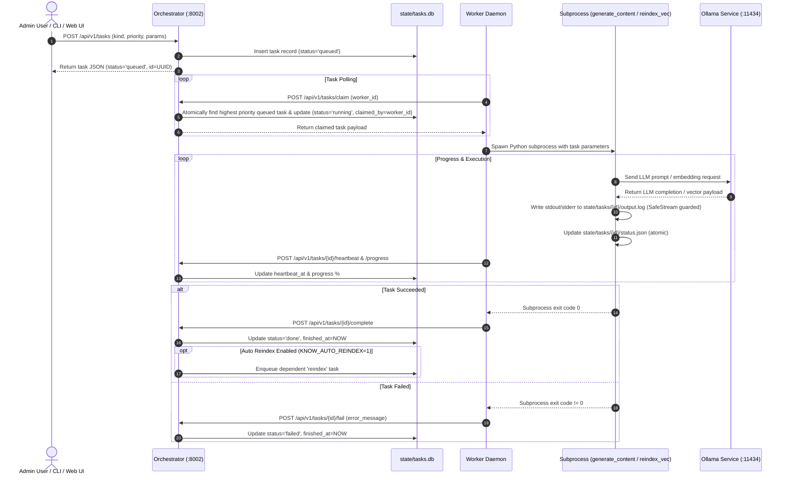

# Architecture & System Design — know-server

This document describes the internal architecture, service topology, module design, database schemas, process isolation primitives, and task execution lifecycle of `know-server`.

---

## 1. System Topology & Service Layering

---

## 2. Directory Structure

- [`orchestrator/`](orchestrator): Fast-API daemon managing task queueing, worker task assignment, status tracking, OTLP queue depth metrics, and orphan recovery.
- [`web/`](web): Administrative Web Panel serving Jinja templates and REST APIs for packs, domains, users, settings, and content management.
- [`server/`](server): Public API Server handling client application feedback submissions (`/api/feedback`).
- [`quizkb/`](quizkb): Core domain library containing configuration, user settings resolution, database schemas, process locks, pack specifications, OpenTelemetry instrumentation, and generation pipeline logic.
- [`scripts/`](scripts): CLI utilities (`know_cli.py`, `knowctl.py`), worker daemon (`worker.py`), vector reindexing (`reindex_vec.py`), pack compilation (`build_qap.py`), and helper scripts.
- [`know-webui/`](know-webui): Independent React 18 + Vite + TypeScript Single Page Application dashboard.
- [`tools/`](tools): Concurrent multi-service development launcher (`dev_launcher.py`) and environment isolation scripts.
- [`tests/`](tests): Domain-partitioned test suite (`integration`, `orchestrator`, `quizkb`, `scripts`, `server`, `web`).

---

## 3. Module Reference & Subsystem Breakdown

### 3.1 Orchestrator Subsystem (`orchestrator/`)
- [`orchestrator/app.py`](orchestrator/app.py): Exposes FastAPI endpoints for task creation (`POST /api/v1/tasks`), worker task claims (`POST /api/v1/tasks/claim`), heartbeats, progress updates, cancellation, and log retrieval. Emits `orchestrator_queue_depth` OpenTelemetry metrics every 30s.
- [`orchestrator/tasks.py`](orchestrator/tasks.py): Implements `TaskManager`, which wraps `state/tasks.db`. Uses SQLite transactions with atomic update logic to manage queue status transitions (`queued` → `running` → `done` / `failed` / `interrupted`). Performs periodic orphan recovery for worker subprocesses.

### 3.2 Web Admin Subsystem (`web/`)
- [`web/app.py`](web/app.py): Entrypoint for the Admin Web Panel on port 8000. Provides Jinja template routes (`/packs`, `/domain/{slug}`, `/users`), REST API endpoints (`/api/v1/packs/*`, `/api/v1/users/*`, `/api/v1/search`), and background health monitoring (`web/net.py`).
- [`web/auth.py`](web/auth.py): Handles user authentication via cookie sessions and API bearer tokens. Enforces origin protection via `SameOriginMiddleware`, validating `Origin` headers on state-changing requests (`POST`, `PUT`, `PATCH`, `DELETE`) to prevent CSRF.
- [`web/db.py`](web/db.py): Manages `state/app.db` schema initialization (`domains`, `campaigns`, `campaign_domains`).

### 3.3 Public API Subsystem (`server/`)
- [`server/app.py`](server/app.py): Public server listening on port 8001. Ingests client feedback via `POST /api/feedback`, recording reports into `state/server.db` with duplicate prevention via `client_uuid`.

### 3.4 Core Library Subsystem (`quizkb/`)
- [`quizkb/settings.py`](quizkb/settings.py): Implements `KnowSettings` (backed by Pydantic Settings). Sourced from `.env`, environment variables, and `state/know.config.yaml` with typo detection and validation.
- [`quizkb/users.py`](quizkb/users.py): User CRUD, bcrypt password hashing, token management, and 5-tier effective generation settings resolution (`defaults` → `user_global` → `per_domain` → `per_lang` → `request_override`).
- [`quizkb/lock.py`](quizkb/lock.py): Provides kernel-level singleton execution guarantees (`ProcessLock`) using `fcntl.flock` on POSIX and `CreateMutexW` on Windows. Used by `tools/dev_launcher.py` and `scripts/worker.py`.
- [`quizkb/io_utils.py`](quizkb/io_utils.py): Provides `SafeStream` stdout/stderr wrappers to catch `EPIPE`/BrokenPipeError on subprocess output streams, preventing task runner crashes.
- [`quizkb/packs.py`](quizkb/packs.py) & [`quizkb/release.py`](quizkb/release.py): CRUD operations for pack specifications (`state/packs.json`) and Format v2 `.qap` zip archive compilation and manifest indexing (`state/manifest.json`).
- [`quizkb/observability.py`](quizkb/observability.py): Configures OpenTelemetry meters (`get_meter`), structured loggers (`get_logger`), and OTLP trace context propagation across services.

### 3.5 CLI & Background Worker Subsystem (`scripts/`)
- [`scripts/know_cli.py`](scripts/know_cli.py): Source for the `know` CLI executable (`config`, `auth`, `status`, `tasks`, `domain`, `users`, `packs`).
- [`scripts/knowctl.py`](scripts/knowctl.py): Administrative maintenance CLI (`status`, `tasks`, `logs`, `backup`, `restore`, `integrity`).
- [`scripts/worker.py`](scripts/worker.py): Independent background polling daemon. Claims tasks from Orchestrator, executes task scripts (`generate_content.py` or `reindex_vec.py`), streams logs to `state/tasks/{id}/output.log`, sends heartbeats, and reconciles execution status.
- [`scripts/reindex_vec.py`](scripts/reindex_vec.py): Generates vector embeddings using Ollama (`embeddinggemma:latest`) and stores vectors into SQLite tables in `state/content.db` via `sqlite-vec`.

---

## 4. Task Execution Lifecycle

---

## 5. Security & Isolation Primitives

1. **CSRF & Origin Verification**: State-changing requests (`POST`, `PUT`, `PATCH`, `DELETE`) with session cookies pass through [`web/auth.py:SameOriginMiddleware`](web/auth.py), which matches the `Origin` header against the server `Host` header.
2. **Process Singleton Locks**: High-risk background services (`dev_launcher.py`, `worker.py`) acquire OS-level locks via [`quizkb/lock.py:ProcessLock`](quizkb/lock.py). If a process dies or crashes, kernel cleanup automatically releases the lock primitive.
3. **Broken Pipe Stream Safeguards**: Worker subprocess output streams are wrapped with [`quizkb/io_utils.py:SafeStream`](quizkb/io_utils.py#L38), catching `EPIPE`/`BrokenPipeError` to prevent process termination when standard streams are closed prematurely.
4. **User Scoping & Access Control**: API bearer tokens and user logins map to domain/language permission scopes managed via [`quizkb/users.py`](quizkb/users.py). Unauthenticated REST requests return HTTP 401 JSON; HTML page requests redirect to `/login`.
