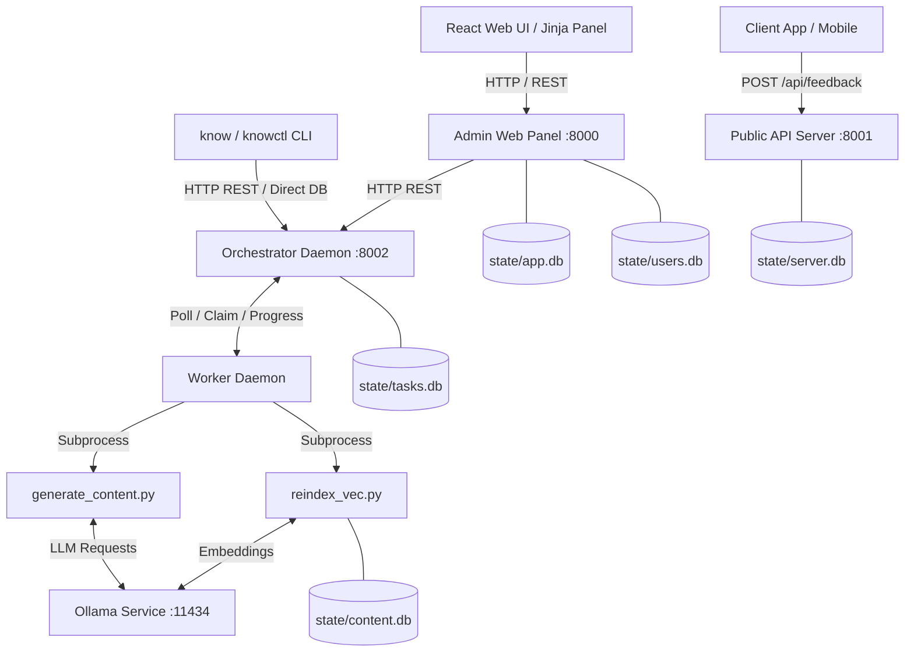

# know-server

`know-server` is the backend server, task orchestrator, content generation pipeline, and administrative service for the **know** (Knowledge Never Overwhelms Wisdom) learning framework ecosystem. It manages AI-driven quiz content generation via Ollama LLMs, vector embedding indexing via `sqlite-vec`, task queue priority scheduling, user authentication and scoping, `.qap` release pack compilation, and public API feedback collection.

---

## Prerequisites & Installation

### Prerequisites
- **Python**: Version 3.11 or higher (see [`pyproject.toml:4`](pyproject.toml#L4)).
- **Node.js**: Version 20.10.0 or higher (see [`know-webui/package.json:6`](know-webui/package.json#L6)).
- **pnpm**: Version 12.8.1 or higher (for `know-webui` React SPA).
- **Ollama**: Local Ollama service running (default `http://127.0.0.1:11434` for generation and embeddings).

### Installation Steps

1. **Install Python dependencies**:
   Using `uv` (recommended):
   ```bash
   uv sync
   ```
   Or using standard `pip`:
   ```bash
   python -m venv .venv
   source .venv/bin/activate
   pip install -e ".[dev,web]"
   ```

2. **Install React Web UI dependencies**:
   ```bash
   pnpm --dir know-webui install
   ```

3. **Configure Environment Variables**:
   Copy the example environment configuration:
   ```bash
   cp .env.example .env
   ```
   Key environment variables supported (see [`quizkb/settings.py:124-170`](quizkb/settings.py#L124-L170)):
   - `DEPLOYMENT_ENV`: Environment mode (`dev` or `prod`; default `dev`).
   - `ADMIN_URL`: Admin web panel URL (default `http://127.0.0.1:8000`).
   - `PUBLIC_URL`: Public API server URL (default `http://127.0.0.1:8001`).
   - `ORCHESTRATOR_URL`: Task orchestrator daemon URL (default `http://127.0.0.1:8002`).
   - `OLLAMA_HOST`: Ollama API service URL (default `http://127.0.0.1:11434`).
   - `KNOW_STATE_DIR`: State directory path (default `state/`).
   - `KNOW_OUTPUT_ROOT`: Output directory path (default `output/`).
   - `KNOW_LOGS_ROOT`: Log output directory (default `state/logs`).
   - `KNOW_SESSION_SECRET`: Session secret key (required when `DEPLOYMENT_ENV=prod`).
   - `OTEL_EXPORTER_OTLP_ENDPOINT`: OpenTelemetry OTLP gRPC/HTTP endpoint (e.g. `http://127.0.0.1:4317`).

---

## Quick Start & Usage

### 1. Initialize Database & Seed Content Metadata
```bash
python scripts/sync_config.py --action import
python scripts/create_user.py admin secret
```

### 2. Launch Backend Microservices & Worker
Run the integrated development launcher to start Orchestrator (port 8002), Admin Panel (port 8000), Public API (port 8001), and Worker Daemon concurrently:
```bash
python tools/dev_launcher.py
```
To launch without the local worker (e.g. when running a remote worker process):
```bash
python tools/dev_launcher.py --remote-worker
```

### 3. Launch React Frontend SPA (`know-webui`)
```bash
pnpm --dir know-webui dev
```
Open `http://localhost:5173` to access the React web dashboard.

### 4. Build & Package Content Packs
Build `.qap` release packages from definition specifications and index the manifest:
```bash
python scripts/make_packs.py
python scripts/update_manifest.py
```

### 5. Interacting with Backend APIs (Curl Examples)

**Submit Public Client Feedback (`server/app.py:53`)**:
```bash
curl -X POST http://127.0.0.1:8001/api/feedback \
  -H "Content-Type: application/json" \
  -d '{
    "client_uuid": "550e8400-e29b-41d4-a716-446655440000",
    "question_uuid": "q123",
    "question_text": "What is TCP?",
    "selected_answer": "UDP",
    "correct_answer": "TCP",
    "language": "en",
    "domain_slug": "networking",
    "article_slug": "tcp-ip-overview",
    "reason_code": "wrong_answer",
    "comment": "Clarification needed",
    "app_version": "1.0.0",
    "locale": "en-US",
    "client_created_at": 1710000000
  }'
```

**List Orchestrator Tasks (`orchestrator/app.py:165`)**:
```bash
curl -s http://127.0.0.1:8002/api/v1/tasks
```

**List Domains via Admin API (`web/app.py:1463`)**:
```bash
curl -s http://127.0.0.1:8000/api/v1/domains
```

---

## Configuration

The application uses a tiered configuration system managed by Pydantic (`quizkb/settings.py`):

1. **`.env` / Environment Variables**: Highest priority runtime overrides.
2. **`state/know.config.yaml`**: Local YAML configuration file for custom settings.
3. **`state/packs.json`**: Pack definitions detailing included domains, languages, filters, and target output paths.
4. **`pyproject.toml`**: Dependency declarations, entrypoint script definitions (`know`, `knowctl`), and test/linter settings.

### Database File Topology
- `state/app.db`: CMS domain and campaign metadata tables (`domains`, `campaigns`, `campaign_domains`).
- `state/tasks.db`: Orchestrator persistent task queue and status table (`tasks`).
- `state/users.db`: User accounts, bcrypt password hashes, API bearer tokens, user settings, and domain permissions.
- `state/server.db`: Public feedback submissions table (`feedback`).
- `state/content.db`: Knowledge articles, questions, translations, and vector embedding tables managed via `sqlite-vec`.

---

## Architecture (High-level)



For complete technical specifications, component breakdown, and sequence diagrams, refer to [`ARCHITECTURE.md`](ARCHITECTURE.md).

---

## CLI Tools Reference

### Operational CLI (`know` — `scripts/know_cli.py`)
```
usage: know_cli.py [-h] {config,auth,status,tasks,domain,users,packs} ...

positional arguments:
  {config,auth,status,tasks,domain,users,packs}
    config              Configuration commands
    auth                Authentication commands
    status              Check system status
    tasks               Task management
    domain              Domain management
    users               User and settings management
    packs               Pack definitions and artifacts
```

### Administrative Control CLI (`knowctl` — `scripts/knowctl.py`)
```
usage: knowctl.py [-h] {status,tasks,logs,backup,restore,integrity} ...

positional arguments:
  {status,tasks,logs,backup,restore,integrity}
    status              Check system status
    tasks               Task management
    logs                View logs
    backup              Create backups
    restore             Restore from backup
    integrity           Run database integrity and parity checks
```

### Background Worker Daemon (`scripts/worker.py`)
```
usage: worker.py [-h] [--orchestrator-url ORCHESTRATOR_URL]
                 [--log-level {DEBUG,INFO,WARNING,ERROR}] [--allow-duplicate]
```

### Development Launcher (`tools/dev_launcher.py`)
```
usage: dev_launcher.py [-h] [--remote-worker]
```

---

## Development & Testing

### Running Tests
Execute the pytest suite using the project environment:
```bash
.venv/bin/pytest
```
*The test suite contains 620 tests covering unit logic, integration workflows, CLI functionality, and web/API routes.*

### Code Linting & Formatting
Run `ruff` to verify code style and adherence:
```bash
.venv/bin/ruff check .
```

### Building Release Artifacts
Build all `.qap` release archives defined in `state/packs.json`:
```bash
python scripts/make_packs.py
python scripts/update_manifest.py
```
To build a specific `.qap` pack manually:
```bash
python scripts/build_qap.py --release output/release --out state/qaps/pack_networking.qap --id pack_networking --version 1.0.0 --kind campaign
```
